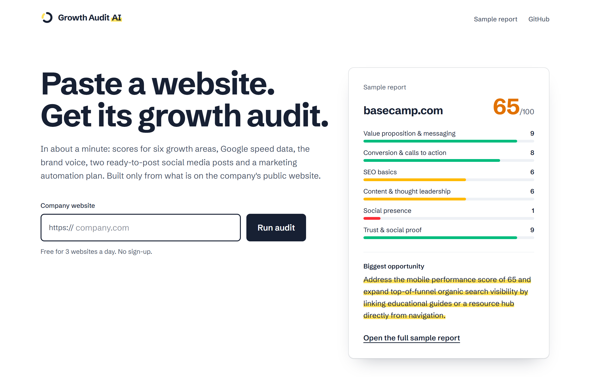
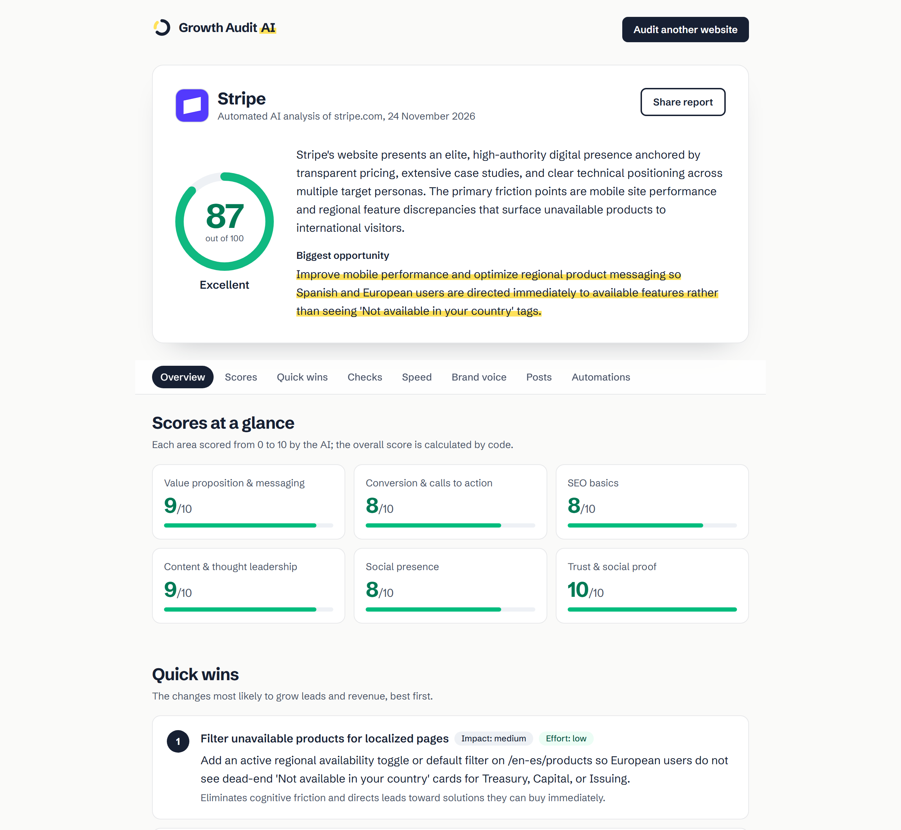
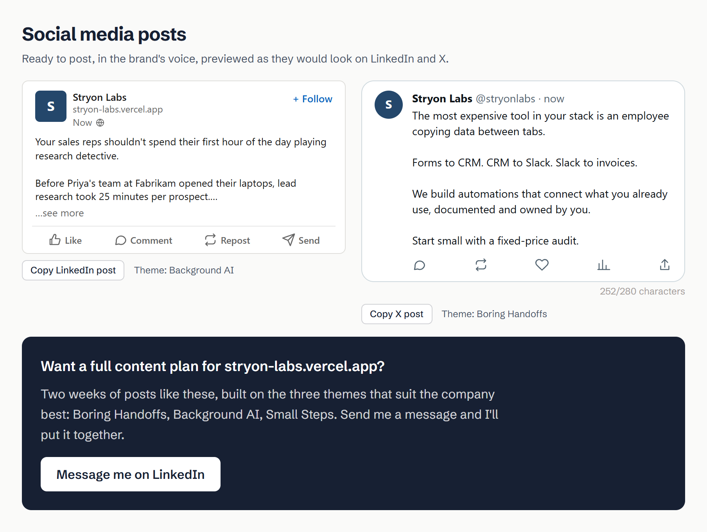
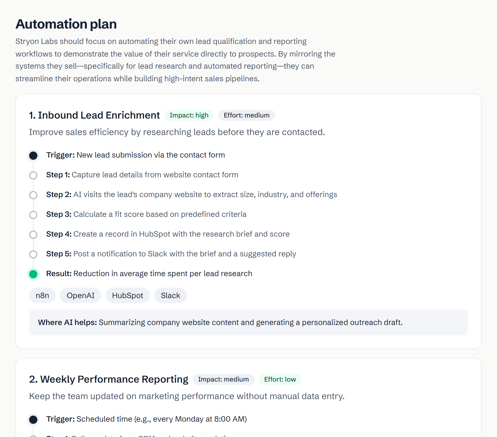
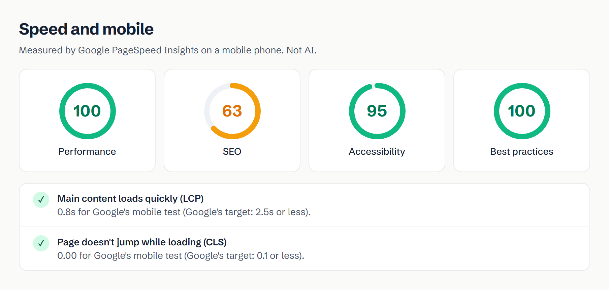
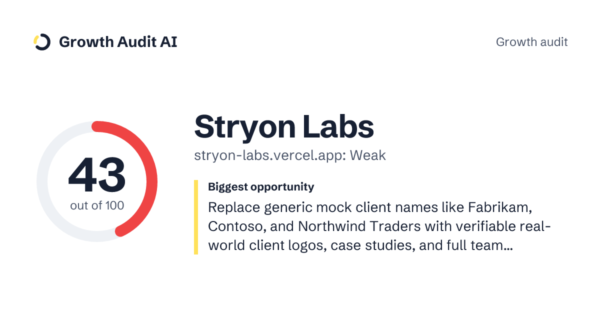
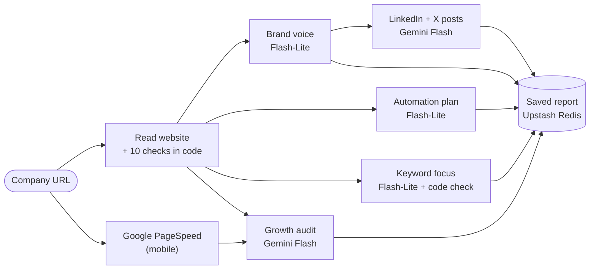

<p>
  
</p>

# Growth Audit AI

**Paste a company website. Get its growth audit in about a minute.**

Scores for six growth areas, Google speed data, the brand voice, ready-to-post LinkedIn and X posts and a marketing automation plan, built only from what is on the company's public website.

**Live:** [growth-audit-ai.vercel.app](https://growth-audit-ai.vercel.app) · **Sample report:** [Stryon Labs, a fictional agency](https://growth-audit-ai.vercel.app/r/Zj6Citjzcu) · **2-minute demo:** [video on LinkedIn](https://www.linkedin.com/posts/marc-cantacuzene_growthmarketing-aiautomation-marketingautomation-ugcPost-7531748839616266240-ltMZ/) · **How it's built:** [docs/HOW-IT-WORKS.md](docs/HOW-IT-WORKS.md)



> The screenshots and the sample report show **Stryon Labs**, a fictional AI agency built as a [demo website](https://stryon-labs.vercel.app) so no real company is judged in public. The audit itself is real, produced by the same pipeline as any other.

## What you get

| | |
| --- | --- |
| **Growth score** | Six areas scored 0–10 (messaging, conversion, SEO, content, social, trust); the overall score is calculated by code, not the AI |
| **Quick wins** | Specific changes ranked by impact. Visitors see the first one; the rest are offered on request (a lead-generation hook) |
| **Website checks** | Ten facts measured in code: HTTPS, title and meta length, one H1, calls to action, pricing page, blog, social links… |
| **Speed and mobile** | Google PageSpeed scores and Core Web Vitals, preferring real Chrome-user data over the lab test |
| **Brand voice** | Tone, audience and positioning, each backed by quotes that are checked word for word against the site |
| **Two social posts** | One for LinkedIn and one for X, previewed as they'd look in each feed with the company's name, logo and colour |
| **Automation plan** | The three marketing workflows most worth automating: trigger → steps → result, tools, and where AI helps |
| **Keyword focus** | The search phrases the site targets, with where each appears (title, H1, headings, meta, URL) measured in code, plus five phrases worth adding. Not Google rankings |
| **A link to share** | Every report gets its own page and a preview card for LinkedIn, Slack and WhatsApp |



<table>
  <tr>
    <td></td>
    <td></td>
  </tr>
  <tr>
    <td></td>
    <td></td>
  </tr>
</table>

## How it works



- **Code does the facts and the maths, the AI does the judgement and the writing.** Website checks, speed data and the overall score are never left to the model.
- **AI output is treated as untrusted input.** Every answer must match a Zod schema (for example "exactly 3 automations", "the X post fits in 280 characters"); if it doesn't, the model is told the exact problem and tries once more. Quotes are checked word for word against the website.
- **Parallel where possible.** PageSpeed starts at second 0; brand voice, audit and automation plan run side by side; the posts start as soon as the brand voice is ready. A full audit takes about a minute, streamed live to the page step by step.
- **One failed step doesn't kill the report.** Each step reports its own error and the rest still appears.

## Numbers

| | |
| --- | --- |
| Time per audit | about 55 seconds (PageSpeed and the AI provider vary) |
| Cost per audit | about $0.026, measured per step from logged token counts |
| Cost cut | about 60%, by moving two steps to a cheaper model and turning the model's hidden "thinking" down to low |
| Quote accuracy | typically every quote verified on the site (for example 10 of 10 on the sample report) |

## Built for growth

- **Lead generation:** one free quick win and two free posts, then "message me on LinkedIn" for the full fix list or a content plan, or leave an email under the report (optional, stored with consent, deleted after 12 months, listed on `/stats`). Hidden fixes are removed on the server, not just blurred.
- **Funnel tracking without cookies:** daily counts of visits → audits → report views → LinkedIn clicks, on a private dashboard at `/stats`.
- **Lead alerts:** a click on a LinkedIn offer posts the website and offer to a Discord or Slack channel.
- **Shareable by design:** every report link unfurls into a branded preview card with the score.
- **Abuse and cost control:** 3 free audits per visitor and 15 per day site-wide (hashed IPs, no personal data stored), plus a monthly spending cap at the AI provider.

## Tech stack

Next.js 15 (App Router, TypeScript) · Tailwind CSS · Google Gen AI SDK (Gemini 3.8 Flash + 3.1 Flash-Lite) or the Anthropic SDK (Claude), switchable with one setting · Zod · Cheerio · Google PageSpeed Insights API · Upstash Redis + Ratelimit · `next/og` for preview cards · Vercel

## Run it locally

```bash
npm install
cp .env.example .env.local   # then fill in the keys below
npm run dev                  # http://localhost:3000
```

| Variable | What it's for |
| --- | --- |
| `AI_PROVIDER` | `gemini` or `anthropic` |
| `GEMINI_API_KEY`, `GEMINI_MODEL`, `GEMINI_MODEL_FAST` | Google AI Studio key and the two models (strong and cheap) |
| `ANTHROPIC_API_KEY`, `ANTHROPIC_MODEL` | Only when `AI_PROVIDER=anthropic` |
| `PAGESPEED_API_KEY` | Google PageSpeed Insights (free); without it, the speed step is skipped |
| `UPSTASH_REDIS_REST_URL`, `UPSTASH_REDIS_REST_TOKEN` | Saved reports, limits and stats; without them, reports aren't saved |
| `ACCESS_CODE` | Unlimited audits, full reports and the `/stats` dashboard for the owner |
| `LEAD_ALERT_WEBHOOK_URL` | Optional Discord or Slack webhook for lead alerts |

## Project structure

```
app/
  page.tsx                  landing page with the live sample report
  audit/page.tsx            audit page: URL in, live progress, full report out
  r/[id]/                   a saved report, plus its share preview image
  stats/page.tsx            private funnel dashboard
  legal-notice/, privacy/   legal pages (Spanish law)
  api/audit/                runs the pipeline and streams progress (NDJSON)
  api/track/, api/stats/    funnel counters and dashboard data
  api/logo/[id]/            company logos served from our own domain
components/
  report.tsx                the report
  social-post.tsx           LinkedIn and X post previews
  logo.tsx                  logo and mark
lib/
  reader/                   website reader, robots.txt, code checks, brand detection, PageSpeed
  ai/                       provider switch, per-step models, validate-and-retry
  schemas/                  Zod schemas, one per AI step
  steps/                    one file per pipeline step, plus the grounding check
  store/                    Redis: reports, rate limits, stats
prompts/                    prompts, kept separate so they're easy to improve
docs/HOW-IT-WORKS.md        every decision and why, with the honest limits
```

## Privacy

The tool reads public website content only and respects robots.txt. No cookies, no tracking profiles. Visitors are counted for the daily limit by a one-way hash of their IP address; company logos are proxied so visitors' browsers never contact third-party sites. Details: [privacy policy](https://growth-audit-ai.vercel.app/privacy).

## Author

Built by **Marc Cantacuzene** as a portfolio project for growth marketing and AI automation roles. [LinkedIn](https://www.linkedin.com/in/marc-cantacuzene/)
